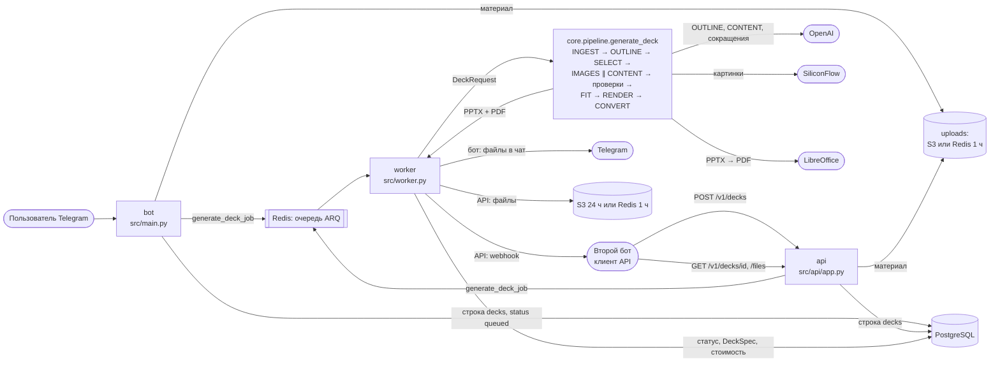

# Архитектура

Как сервис устроен **сейчас, в коде** — не план. Пишется по коду и правится вместе с ним (D-080): нашли расхождение — прав код, правьте документ в той же задаче. Задуманное, но не сделанное — в `docs/ROADMAP.md`; почему сделано так — `docs/DECISIONS.md` по номеру. Словарь терминов и карта репозитория — `README.md`.

---

## 1. Принципы

Каждый принцип соблюдается в коде, нарушение — блокер ревью (номер в скобках, `docs/REVIEW.md`).

1. **Ядро не знает про Telegram и HTTP** (B10). `src/core` не импортирует бот, API, воркер, aiogram и FastAPI. Бот и API — адаптеры: принимают запрос, создают строку `decks`, ставят задачу. Воркер вызывает ядро и отдаёт результат. Порядок этапов знает только `src/core/pipeline.py`.
2. **`DeckSpec` — единственное промежуточное представление.** Все этапы после OUTLINE читают и дописывают его, рендерер рисует его как есть и ничего не решает (B8).
3. **Числа диаграмм не проходят через модель** (B9, D-028). Модель указывает набор данных и колонки, значения код берёт из `SourceDigest.datasets`.
4. **Содержание слайда хранится по смыслу kind, а не по слотам варианта** (D-031). Смена варианта или темы не требует LLM.
5. **Вид — в файлах, не в коде.** Вариант — `layouts/<kind>/<variant>.yaml`, тема — `themes/<id>.yaml`; вместимость слотов для промпта код считает из тех же YAML.
6. **Деградация вместо падения** (B11). У каждого этапа есть запасной путь (раздел 5), каждый такой случай пишется в `DeckSpec.degradations`. Колода падает целиком (`DeckError` с кодом) только тогда, когда отдать нечего.

---

## 2. Сервисы

Три сервиса Railway из **одного Docker-образа** (`Dockerfile`). CMD образа — `src/start.py`: он читает `SERVICE_ROLE` и заменяет себя нужным процессом (D-062). Файлы Config as Code Railway не используются.

| Сервис | `SERVICE_ROLE` | Процесс | Что делает |
|---|---|---|---|
| bot | `bot` (по умолчанию) | `src/main.py`, aiogram 3 | Диалог в Telegram, сводка, профиль, оплата; ставит колоду в очередь. Доступ — только разрешённым Telegram ID, если они заданы (`src/bot/access.py`, D-081) |
| worker | `worker` | ARQ, `src/worker.py` (`WorkerSettings`) | Собирает колоды (`generate_deck_job` — новый движок, `generate_presentation_job` — старый, питч-дек), отправляет файлы в Telegram, webhook клиентам API, уведомления владельцу |
| api | `api` | uvicorn, `src/api/app.py` | REST API v1 для второго бота (`docs/API.md`): ключи, лимиты, создание колоды, статус, файлы, темы |

Плюс PostgreSQL и Redis — сервисы Railway; S3-совместимое хранилище — внешнее и необязательное (сейчас на проде не подключено).

- **Миграции** применяет каждый процесс при старте (`db/session.init_db` → `alembic upgrade head`, D-009). Миграции только добавляющие, поэтому откат кода без отката БД безопасен.
- **Порядок выкатки — воркер раньше бота и API:** новые аргументы задач должен понимать воркер до того, как их начнут ставить.
- **Какие переменные нужны какому сервису** — шапка `.env.example`; все настройки читаются только через `src/config.py`.
- **Бот должен быть один экземпляр:** склейка длинного текста держит буфер в памяти процесса (`bot/text_join.py`).

---

## 3. Поток данных

### 3.1 Путь одного запроса (бот)

| Шаг | Что происходит | Где |
|---|---|---|
| 0 | Доступ: если задан `BOT_ALLOWED_TELEGRAM_IDS`, остальным — ссылка на основной бот | `src/bot/access.py` |
| 1 | Диалог: тип, тема, материал, сводка с кнопками «Сменить…» | `src/main.py` (обработчики), `src/dialog.py` (тексты и клавиатуры сводки) |
| 2 | «Сгенерировать»: материал — во временное хранилище, строка `decks` (status `queued`), задача в очередь | `main.generate_deck`, `src/generation/uploads.py`, `src/core/storage/decks.py` |
| 3 | Воркер берёт задачу, читает `DeckRequest` из `decks`, правит статусное сообщение в чате по этапам | `worker.generate_deck_job`, `src/bot/delivery.py` (`StatusMessage`) |
| 4 | Ядро собирает колоду (этапы — 3.2) | `src/core/pipeline.py` |
| 5 | Результат — в `decks`, файлы — в чат одним альбомом, списывается генерация | `worker.generate_deck_job`, `bot/delivery.send_files`, `db/session.count_generation` |

Через API шаги 1–2 делает `POST /v1/decks` (`src/api/app.py: create_deck`); на шаге 5 файлы кладутся в хранилище (`core/storage/files.py`), прогресс CONTENT — в Redis для `GET`, клиенту ставится webhook (`api/webhook.py`). Подробно — `docs/features/rest-api.md`.

Питч-дек пока идёт старым движком (HTML → PDF через Playwright, `src/generation/`) задачей `generate_presentation_job`; выбор движка — `dialog.engine_for`.

### 3.2 Этапы ядра (`src/core`)

| # | Этап | Что делает | Код | Выход |
|---|---|---|---|---|
| 1 | INGEST | Разбирает материал (docx, pdf, pptx, txt, текст): фрагменты текста и таблицы с числами | `core/ingest/` | `SourceDigest` |
| 2 | OUTLINE | LLM строит план: жанр, тезисы, по слайду — kind, роль, заголовок; код проверяет план; титул — тема без пожеланий | `core/planning/outline.py`, `title.py`, `datasets.py` | список `PlannedSlide` |
| 3 | SELECT | Код выбирает вариант макета для каждого слайда по вместимости и разнообразию (детерминированно по `seed`) | `core/selection/select.py` | вариант на слайд |
| 4 | IMAGES | ИИ-картинки SiliconFlow, параллельно с CONTENT; не успела — вариант без картинки | `core/images/` | файлы картинок |
| 5 | CONTENT | LLM пишет текст каждого слайда по схеме его kind, слайды параллельно | `core/content/fill.py` | `Slide.content` |
| 6 | Проверки текста и чисел | Мусор генерации (иероглифы, склейки, английские вставки); числа не из источника — перегенерация слайда | `core/checks/text.py`, `core/checks/facts.py` | исправленный `DeckSpec` |
| 7 | Типографика | Неразрывные диапазоны, единицы, разряды; десятичная запятая по языку | `core/text/typography.py` | — |
| 8 | FIT | Подгонка под макет без обрезки: кегль → другой вариант → «сократи до N знаков» → два слайда; заполненность не ниже 40% | `core/fitting/fitter.py`, `resolve.py`, `fill.py`, `metrics.py` | `Slide.fit` |
| 9 | RENDER | `DeckSpec` → PPTX (python-pptx): фигуры, текст, нативные диаграммы, иконки; финальная проверка вёрстки готового файла | `core/render/pptx/`, `core/checks/layout.py` | PPTX |
| 10 | CONVERT | PPTX → PDF через LibreOffice | `core/render/pdf/convert.py` | PDF |

Общие части ядра: `core/llm/` — клиент LLM (structured outputs, повторы, 429, учёт токенов и стоимости); `core/models/` — все структуры данных (источник истины контрактов); `core/storage/` — строка `decks`, файлы колод, прогресс. Как работает каждый этап и его подводные камни — файлы `docs/features/`.

---

## 4. Время и параллелизм

Лимит продукта — 2 минуты от нажатия кнопки до файла без учёта очереди (ТЗ 6.1).

- **Дедлайн колоды** — `DECK_DEADLINE_SECONDS` от старта задачи. CONTENT получает время до дедлайна минус резерв на рендер и конвертацию (`RESERVE_SECONDS` в `src/core/pipeline.py`); незавершённые слайды собираются из плана без LLM.
- **`job_timeout` воркера** (`JOB_TIMEOUT_SECONDS` в `src/worker.py`) — страховка от зависания кода, больше дедлайна; его срабатывание — баг.
- **Параллелизм:** колод одновременно на воркер — `MAX_CONCURRENT_JOBS` (`src/worker.py`); вызовов CONTENT на колоду — `CONTENT_CONCURRENCY`; вызовов LLM на процесс, общий семафор всех колод и обоих движков — `LLM_MAX_CONCURRENCY` (D-078); конвертаций LibreOffice на процесс — `LIBREOFFICE_MAX_PARALLEL`, у каждой свой профиль. Значения по умолчанию — `src/config.py`.
- **Колоды бота и API идут в одну очередь** по порядку поступления; поток API ограничен лимитами ключа (ТЗ 11, вопрос 6).
- **Кэш промпта провайдера:** системный промпт CONTENT одинаков байт в байт у всех слайдов колоды, всё про один слайд — в сообщении user (`docs/features/content.md`).
- Воркер при старте прогревает LibreOffice, чтобы первая колода не платила за холодный старт.

---

## 5. Деградация и ошибки по этапам

| Этап | Сбой | Что происходит | Колода |
|---|---|---|---|
| INGEST | скан без текста, битый файл, zip-бомба, таймаут разбора | ошибка с кодом (`SCAN_WITHOUT_TEXT`, `BAD_FILE`, `PARSE_TIMEOUT`, `FILE_UNSUPPORTED`) | `failed`, лимит не списан |
| INGEST | текст длиннее предела ядра | берётся начало, `truncated` в `SourceDigest`, предупреждение в подписи | продолжается |
| — | ссылка на материал истекла (задача пролежала в очереди дольше TTL) | `UPLOAD_EXPIRED` | `failed` |
| OUTLINE | 2 попытки без годного плана | `OUTLINE_FAILED` | `failed` |
| OUTLINE | диаграмма без данных, «по теме» диаграмма, лишние слайды | код исправляет план, пишет деградацию | продолжается |
| SELECT | нет применимого варианта | запасной вариант kind, затем `bullets` | продолжается |
| IMAGES | нет ключа, ошибка, не успела | вариант без картинки того же kind | продолжается |
| CONTENT | 2 попытки без валидного ответа или дедлайн | слайд-утверждение из плана без LLM | продолжается |
| Проверки | мусор или число не из источника | одна перегенерация; не помогло — фрагмент или число убирается | продолжается |
| FIT | не влезает | вариант вместительнее → сокращение моделью → два слайда → без необязательного поля; не помогло — `RENDER_FAILED` | продолжается или `failed` |
| RENDER | финальная проверка PPTX нашла вылет или наложение | исправление через FIT, до 2 раундов; не помогло — `RENDER_FAILED` | продолжается или `failed` |
| CONVERT | LibreOffice упал или таймаут | колода отдаётся одним PPTX, деградация `convert` | `done` |
| Выдача в Telegram | не принял файл | до 3 повторов (`bot/delivery.py`) | `done`; лимит — только после успешной отправки |
| Воркер | упал посреди колоды | **сторожа нет:** строка остаётся `processing`; API через 15 мин отдаёт её как `failed` / `DEADLINE_EXCEEDED`, не меняя строку (`api/status.py`) | — |

**Коды ошибок** — `DeckError` в `src/core/pipeline.py`; текст пользователю бота — `bot/delivery.error_text`; клиенту API — `docs/API.md`, раздел 6.

---

## 6. Где что хранится

| Что | Где | Срок |
|---|---|---|
| Пользователи, тариф, профиль, прошлый выбор в сводке | PostgreSQL `users` | бессрочно |
| Колода: параметры (`request`), статус и этап, `DeckSpec`, длительности, токены, стоимость, деградации, предупреждения, код ошибки | PostgreSQL `decks` (`src/db/models.py`) | бессрочно |
| Клиенты API: хэш ключа, лимиты, webhook | PostgreSQL `api_clients` | бессрочно |
| Колоды старого движка (питч-дек) | PostgreSQL `presentations` | бессрочно |
| Присланный материал | S3, если настроен, иначе Redis (`src/generation/uploads.py`) | до конца обработки; без S3 — TTL 1 ч |
| Очередь задач | Redis (ARQ) | до выполнения |
| Состояние диалога бота | Redis (FSM aiogram) | — |
| Прогресс CONTENT для `GET /v1/decks/{id}` | Redis (`core/storage/progress.py`) | 2 ч |
| Файлы колод API | S3 (24 ч) или Redis (1 ч) — `core/storage/files.py`, D-058 | см. слева |
| Файлы колод бота | не хранятся: отправляются в чат из памяти | — |
| `SourceDigest` | не хранится после колоды | — |
| Макеты, темы, шрифты, иконки, промпты | репозиторий, копируются в образ | с версией кода |

Таблица `deck_revisions` заведена под правки в боте, но не используется.

---

## 7. Внешние сервисы

| Сервис | Для чего | Где в коде и настройки |
|---|---|---|
| **OpenAI API** (напрямую, D-078) | OUTLINE, CONTENT, сокращение и исправление текста; старый движок | `core/llm/`; модель, уровень рассуждений и адрес — `OPENAI_MODEL`, `OPENAI_REASONING_EFFORT`, `OPENAI_BASE_URL`, по этапам — `LLM_MODEL_*`, `LLM_EFFORT_*`. Параметры запроса и цены по провайдеру — `prompts/models.yaml`, доллары → рубли по `USD_RUB_RATE`. На 429 вызов ждёт по `retry-after` и повторяется. Откат на ProxyAPI — сменой `OPENAI_BASE_URL` и ключа, цены переключатся сами |
| **SiliconFlow**, Z-Image-Turbo (D-067) | ИИ-картинки: титул и несколько слайдов | `core/images/`, параметры — `prompts/v2/images/`, ключ — `SILICONFLOW_API_KEY` (без ключа колоды без картинок). Надпись провайдера срезается по правилу `marking` (D-079) |
| **LibreOffice** | PPTX → PDF | `core/render/pdf/convert.py`; ставится пакетом в образ и в CI |
| **Playwright / Chromium** | PDF старого движка (питч-дек) | `src/generation/`; уходит вместе со старым движком |
| **Telegram Bot API** | бот; отправка файлов воркером; уведомления владельцу | `TELEGRAM_BOT_TOKEN` у бота и воркера; у api токена нет — уведомления о лимитах клиентов отправляет воркер (`api/limit_alerts.py`) |
| **PostgreSQL** | пользователи, колоды, клиенты API | `db/models.py`, миграции — `db/migrations/` |
| **Redis** | очередь ARQ, FSM бота, временные файлы, прогресс, файлы колод API без S3, лимиты частоты API | `REDIS_URL` |
| **S3-совместимое хранилище** (необязательно, D-042) | материал и файлы колод API на 24 ч | `core/storage/files.py`, переменные `S3_*` |

---

## 8. Наблюдаемость

- **Логи** — JSON, одна строка — один объект; в воркере в каждой строке `deck_id` текущей задачи, длительности этапов — `stage()` (`src/logging_setup.py`).
- **Учёт в `decks`:** `durations_ms` по этапам, `usage` (токены и картинки по этапам), `cost_rub`, `degradations`, `warnings`, `error_code`.
- **Уведомления владельцу:** 80% и 100% суточного лимита клиента API (`api/limit_alerts.py`, D-068). Ежедневной сводки и алертов по доле `failed` нет.
- **Качество до мёржа** — golden и стресс-галерея в CI (`docs/features/quality.md`).

---

## 9. Безопасность

- Материал пользователя идёт в промпт только внутри разметки данных с инструкцией не выполнять команды из него (`core/ingest/render.py`).
- Лимиты размера и проверка zip (docx, pptx) — до разбора; присланный файл удаляется после обработки.
- Ключи API хранятся только хэшем SHA-256, ключ показывается один раз; сообщение бота с новым ключом удаляется через 5 минут (`docs/features/rest-api.md`).
- Секреты — только в переменных окружения (`README.md`, «Правила»).
